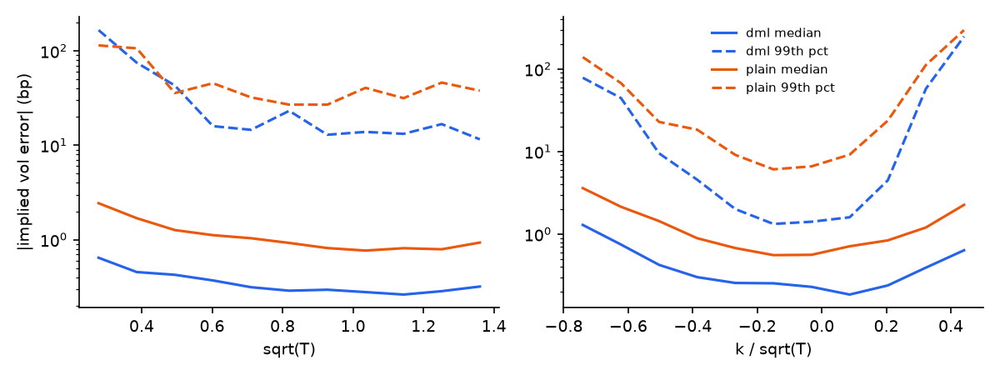
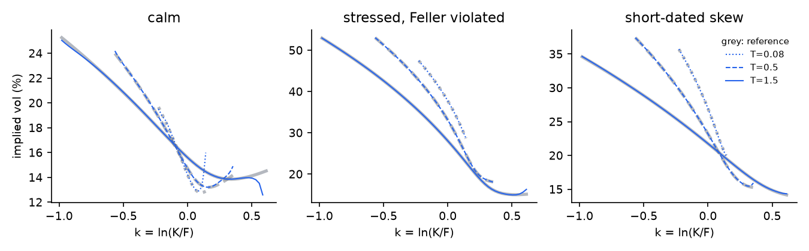
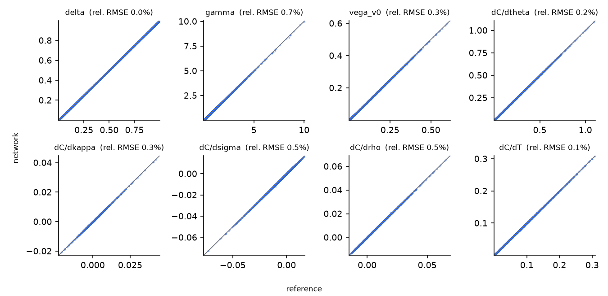
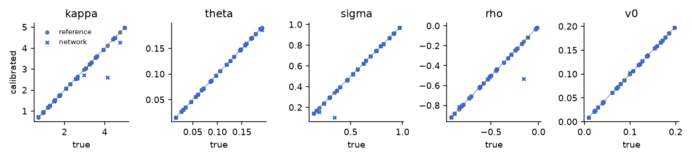

# Neural Heston pricer: independent validation report

*Louis Delacour, October 2026. Code, data generation and every number in this report:
`python -m neural_heston.validate` and `python -m neural_heston.report` in the project repository (github.com/louisdelacour21/Neural-heston). Interactive demo: neural-heston.streamlit.app.*

> **Summary.** On a test set of 16,384 points never seen in training, the final network prices with an RMSE of 9.6e-6 in forward units (0.1 bp of the forward) and an implied-vol error of 0.8 bp on average, 7.5 bp at the 99th percentile. Its Greeks match the exact ones to within 1 % of their dispersion, gamma included. Calibrated through the network, 25 random surfaces reprice with the exact pricer to 0.4 bp (median) and 9.7 bp (worst). Differential training is what makes this possible: at equal architecture it divides the price error by 4 and the Greek errors by 4 to 8. The model is **fit for use inside its training box**, under two conditions: prices are floored at intrinsic value (0.13 % of raw outputs are slightly negative, at worst −1.7e-4), and the network is not used beyond the box, where errors grow up to tenfold. The speed gain over a vectorised reference is real but moderate on CPU (26× for 10,000 prices): the case for the network is large batches such as exposure simulation, not a single calibration.

## 1. Scope and model under review

**Purpose.** The model approximates the price of European calls under the Heston (1993) stochastic volatility model by a
neural network, to replace the semi-analytic pricer where it is the bottleneck: calibration to option surfaces, large
scenario grids and the repeated revaluations of exposure simulation (CVA). Puts follow by parity.

**Inputs and output.** Seven inputs: the five Heston parameters (mean reversion κ, long-run variance θ, vol of vol σ,
correlation ρ, initial variance v0), log-moneyness k = ln(K/F) and maturity T. The output is the call price in forward
units, C / (DF · F), so that rates and dividends do not enter the network. Greeks are obtained by automatic
differentiation of the network.

**Domain of use.** The network is trained and validated on the box below. Use outside the box is not approved
(section 7).

| input | κ | θ | σ | ρ | v0 | k / √T | T (years) |
|---|--:|--:|--:|--:|--:|--:|--:|
| range | 0.5 – 5 | 0.01 – 0.2 | 0.1 – 1 | −0.95 – 0 | 0.005 – 0.2 | −0.8 – 0.5 | 0.05 – 2 |

Strikes are bounded in k / √T, so that the strike range widens with maturity as a market grid does. The box covers the
Feller-violating region (2κθ < σ²), where many market calibrations land, on purpose.

**Architecture.** The price is written as a Black price plus a learned correction:

C = Black(k, T, w) + 0.1 · √T · g(features),

where w = θT + (v0 − θ)(1 − e^(−κT)) / κ is the Heston expected integrated variance, and g is a fully connected network
(5 hidden layers of 256 softplus units). The Black term already has the right level, wings and term structure, so the
network only learns the smile, which is small and smooth. The features are log κ, log θ, σ, ρ, log v0, k / √T and √T,
rescaled to [−1, 1]. Softplus activations make the network infinitely differentiable, which the Greeks and
the no-arbitrage tests need.

**Training: differential machine learning** (Huge & Savine, 2020). The loss fits the prices *and* their seven
derivatives with respect to the inputs:

L = mean[((Ĉ − C) / s_C)²] + λ · mean over inputs i of [((∂Ĉ/∂xᵢ − ∂C/∂xᵢ) / s_i)²],  with λ = 1,

each term scaled by the standard deviation of its label. The derivative labels cost little: they come from automatic
differentiation of the reference pricer. The baseline under review is the same network trained on prices only (λ = 0).

## 2. Reference pricer and data

The labels and every test in this report come from an independent implementation of the Heston price:

- **Lewis (2001) single integral** C = 1 − e^(k/2)/π ∫₀^∞ Re[e^(−iuk) φ(u − i/2)] / (u² + ¼) du, with the
  "little trap" form of the characteristic function (Albrecher et al., 2007), which has no branch-cut discontinuity;
- Gauss–Legendre quadrature on 1024 nodes, after the change of variable u = a(eˢ − 1) with a = 1 / √w. The cut-off
  is chosen from the linear decay rate of |φ|, not from a Gaussian bound, which is too short at large σ and short
  maturities;
- written in PyTorch complex128, so that autograd gives exact derivatives of the quadrature, the Greeks and the
  differential labels.

Checks of the reference (`tests/test_heston.py`, 18 tests):

| check | tolerance |
|---|--:|
| adaptive scipy quadrature on the same integral (64 random points) | 1e-9 |
| `riskhub-engine` Heston pricer, written separately for the Risk Hub project | 2e-5 |
| Andersen (2008) QE Monte Carlo, 300k paths | 4 standard errors + 2e-4 |
| Black–Scholes limit (σ → 0) | 1e-5 |
| autograd Greeks against finite differences | 1e-6 abs. + 1e-5 rel. |
| no-arbitrage price bounds, calls and puts | 1e-10 |

**Data.** 131,072 training points and 16,384 test points drawn from scrambled Sobol sequences with different seeds.
Maturity is sampled uniformly in √T to put more points at short maturities, where the smile is steepest. Every
point has its price and its seven derivatives.

{{table:training}}

Times are wall-clock on one laptop CPU (no GPU). The two final models trained at the same time; a pause of the
machine during the differential run is left out.

## 3. Accuracy

### 3.1 Ablation: what each design choice buys

Four models trained on the same data, on the same test set:

- **v0**: the first version, price = √T · softplus(g), 4 × 128 network, 80 epochs;
- **control variate**: the final architecture, 5 × 256, 250 epochs;
- **price only / differential**: λ = 0 or λ = 1.

{{table:ablation}}

Prices are in forward units: 1e-4 is one basis point of the forward. Implied-vol errors are computed where the
time value of the option (price minus intrinsic value) exceeds 1e-4, since implied vol is ill-conditioned below,
for deep in-the-money calls as much as for deep out-of-the-money ones. "Viol." is the share of grid points where a
static no-arbitrage condition fails (section 4). The Greek errors are RMSE divided by the dispersion of the true Greek.

Each step pays. The control variate (a Black price at the Heston expected variance) is the largest single gain: with the same differential loss, the price RMSE falls from 7.5e-4 to 9.6e-6, and the 99th percentile of the implied-vol error from 417 bp to 7.5 bp. The network no longer has to learn the level and the wings of the price, only the smile. Differential training then divides the error again, by 4 on prices and 3.3 on the implied-vol 99th percentile, against the same network trained on prices only, at no cost in data: the derivative labels come with the prices. It also improves what the price loss does not see directly: gamma error falls from 3.3 % to 0.7 % and butterfly violations from 0.23 % to 0.08 % of the grid. The cost is training time, about 1.6× per run. The first version (v0) would not pass validation: 58 bp average implied-vol error, 4.5 % butterfly violations for its price-only variant.

### 3.2 By slices of the domain

Risk-relevant slices of the test set, final model:

{{table:slices}}

No slice of the domain breaks down. The hardest are the ones expected: deep out-of-the-money calls (99th percentile 14.8 bp), strong negative correlation (10.4 bp), the Feller-violating region and short maturities (about 9.5 bp each). Prices are just as accurate in those regions (RMSE between 6e-6 and 1.4e-5): the larger implied-vol errors come from the smaller vega there, which magnifies a given price error. The largest single error, 75 bp, is a deep out-of-the-money call with a time value close to the 1e-4 threshold. Accuracy near the edges of the box (any input within 5 % of a bound) is in line with the rest, so the box can be used to its bounds.

### 3.3 Outside the training box

Each row widens one side of the box and leaves the others unchanged (2,048 new points per row).

{{table:ood}}

Outside the box the network degrades, without breaking down. Mild extensions stay acceptable: shorter maturities (down to 4 days) keep the in-box accuracy and faster mean reversion (κ up to 8) costs a factor 1.5. The others cost a factor 2.5 to 10 on the price RMSE, the worst being maturities of 2 to 3 years (×10.5, RMSE 1e-4) and strikes beyond the right edge (×8.6). The differential model degrades less than the price-only one on every row, and much less on positive correlation (3.4e-5 against 5.1e-4): the derivative labels teach the slopes, which extrapolate. These numbers are not a licence: the model is approved inside the box only, and a production wrapper should refuse or flag inputs outside it.

## 4. Static no-arbitrage

A pricer used for calibration or risk must not produce arbitrage on a surface. On a regular grid never seen in
training (400 parameter sets × 45 strikes × 25 maturities, plus fixed-strike calendar grids), three conditions are
tested on the call price:

- call spread: −1 ≤ ∂C/∂K ≤ 0;
- butterfly: ∂²C/∂K² ≥ 0 (C convex in strike, a non-negative density);
- calendar: C non-decreasing in T at fixed K / F.

A violation is counted when a finite difference has the wrong sign by more than 1e-9.

{{table:arbitrage}}

The reference produces no violation at all, which checks the test itself. The network produces few, and small: 0.08 % of the butterfly tests, with the worst a change of slope of 7e-4 between neighbouring strikes, and 0.02 % of the calendar tests, the worst a price decrease of 2e-5 (0.2 bp of the forward). Call-spread violations are more frequent (0.27 %) and come from the far wings, where the true price is a few basis points or less and the network's absolute error is of the same order. The worst sits where the network returns a negative price. They are not rounding: 0.1 % of the tests still fail at a tolerance of 1e-4. Flooring the price at intrinsic value, which section 7 makes a condition of use, removes the negative prices but only part of these violations (0.19 % remain). They sit in the far wings, at a few basis points of the forward, well below bid-ask on any listed surface.

## 5. Greeks

Network Greeks by automatic differentiation, against the exact Greeks of the reference, on 4,096 test points. Delta
and gamma are with respect to the forward. Vega is with respect to v0.

{{table:greeks}}

The network's Greeks are accurate to well under 1 % of their dispersion: 0.05 % for delta, 0.3 % for vega, 0.7 % for gamma, the hardest since it is a second derivative and enters no label. Differential training divides the Greek errors by 4 to 8 against the price-only network. This matters as much as the price accuracy: hedging and risk use the Greeks, and a smooth, accurate gamma is what makes the network usable for exposure simulation.

## 6. Calibration

The intended use. Twenty-five parameter sets are drawn at random in the box. The surface of each (5 maturities from 1
month to 18 months × 9 strikes, 45 implied vols) is priced with the reference. The model is then calibrated back by
least squares in implied vol, once with the network in the loop and once with the reference, from the same starting
point. The parameters stay in the box through a logistic map. The test is twofold:

- **fit**: how close the calibrated surface is to the target, with the pricer used in the loop;
- **reprice**: the calibrated parameters repriced with the *exact* pricer. This is the error a desk would actually
  carry.

{{table:calibration}}

Parameter recovery:

{{table:calibration_params}}

This is the test that matters, and it passes. With the network in the loop, the calibrated parameters reprice the target surface with the exact pricer to 0.4 bp at the median and 9.7 bp in the worst case, well within the bid-ask of listed options, typically tens of basis points of implied vol or more. The reference reaches 0.0 bp, as it must since it generated the targets: this checks the optimiser, not the pricer. Parameter recovery is near exact at the median for all five parameters. In the worst cases, κ, σ and ρ land far from the truth (κ off by 1.5) while the surface still reprices within 10 bp: the Heston surface is nearly flat along some directions of the parameter space, mainly in κ and σ together, so a small pricing error moves the optimum along them. This is a known feature of Heston calibration, and the reprice error is the relevant measure. Fixing or regularising κ, as desks often do, would remove it.

### Speed

Network forward pass against the reference quadrature, on the same CPU:

{{table:speed}}

The gain is moderate, and the honest comparison explains why. The reference is not a slow pricer: it is a single 1024-node quadrature vectorised over the whole batch. Against it, the network is 26× faster on a batch of 10,000 prices and barely faster on a single price, where fixed overheads dominate. A 45-point calibration takes 0.6 s with the network against 0.9 s with the reference. The network pays off when the batch is large: an exposure simulation for CVA, with thousands of paths, dates and trades, is the intended use and the next step of this project. On a GPU, which the network uses with no change, the gap would widen further.

## 7. Conclusions and conditions of use

**Opinion: fit for purpose within the training box, subject to the conditions below.**

1. *Domain.* Use only inside the box of section 1. Inputs outside it must be rejected or flagged.
2. *Price floor.* Floor the output at intrinsic value, max(1 − eᵏ, 0), and cap it at 1, which removes the negative prices (0.13 % of raw outputs).
3. *Implied vol in the far wings.* Where the time value is below 1e-4 of the forward, read implied vols from the exact pricer, not the network: the price is accurate there but implied vol magnifies its error.
4. *Monitoring.* Any change of domain, retraining or new use (exotics, other models) requires a new validation run, which `python -m neural_heston.validate` reproduces end to end.

**Limitations of this review.** The reference is itself a numerical approximation, checked against four independent methods but not exact. The review covers European calls under Heston, with no jumps, no term structure of the parameters and no dividends beyond the forward. Testing is on synthetic surfaces, not on market data. Training and timing are on one laptop CPU.

## References

- Albrecher, H., Mayer, P., Schoutens, W. & Tistaert, J. (2007). The little Heston trap. *Wilmott Magazine*.
- Andersen, L. (2008). Simple and efficient simulation of the Heston stochastic volatility model. *Journal of
  Computational Finance*, 11(3).
- Heston, S. (1993). A closed-form solution for options with stochastic volatility. *Review of Financial Studies*, 6(2).
- Horvath, B., Muguruza, A. & Tomas, M. (2021). Deep learning volatility. *Quantitative Finance*, 21(1).
- Huge, B. & Savine, A. (2020). Differential machine learning. arXiv:2005.02347.
- Lewis, A. (2001). A simple option formula for general jump-diffusion and other exponential Lévy processes.
